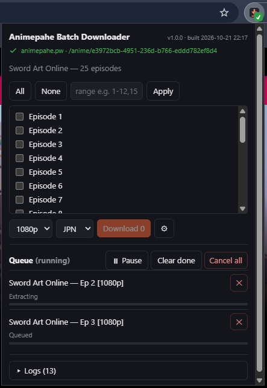

<h1 align="center">Animepahe Batch Downloader</h1>

<p align="center">
  Chrome (MV3) extension that batch-downloads episodes from an open
  <a href="https://animepahe.ru">animepahe</a> anime page.
</p>

<p align="center">
  <a href="https://github.com/barestu/animepahe-browser-dl/releases/latest"></a>
  <a href="https://github.com/barestu/animepahe-browser-dl/actions/workflows/ci.yml"></a>
  <a href="LICENSE"></a>
  
</p>

Because it runs in your real browser, Cloudflare challenges are passed by your own session — no
`cf_clearance` cookie extraction, no headless browser, no cookie file to keep fresh. Pick episodes,
hit Download, get `.mp4` files.

<p align="center">
  
</p>

## Install

### From a release (recommended)

1. Download `animepahe-browser-dl-v<version>.zip` from the
   [latest release](https://github.com/barestu/animepahe-browser-dl/releases/latest).
2. Unzip it somewhere permanent — Chrome loads the extension from that folder every start, so
   don't unzip into Downloads and then clean it out.
3. Open `chrome://extensions`, turn on **Developer mode** (top right).
4. **Load unpacked** → select the unzipped folder.

Chrome will warn about developer-mode extensions on each start, and may disable it after a Chrome
update. That is expected: this extension is **not** on the Chrome Web Store, by design — see
[Caveats](#caveats--known-risks).

### From source

```bash
pnpm install
pnpm build
```

Then **Load unpacked** → select `dist/`. Needs Node 20+ and `pnpm`.

Developing? `pnpm dev` runs Vite with CRXJS HMR (still load `dist/`). The popup header prints the
version and build timestamp, which is how you tell which build Chrome actually has. Full script
table and architecture rules are in [CONTRIBUTING.md](CONTRIBUTING.md).

### Requirements

- Chrome / Chromium **116+** (offscreen documents, `declarativeNetRequestWithHostAccess`).
- A working animepahe session in that browser — if the site loads for you, the extension works.

## Usage

**1. Open an anime page** (`…/anime/<id>`) and look at the toolbar icon. It carries the verdict
itself: a green ✓ corner means the tab is downloadable, a red ✗ means you're on animepahe but the
wrong kind of page (the episode list lives on the anime page, not the play page), plain means the
tab is unrelated.

**2. Click the icon.** The popup lists every episode, fetched through animepahe's release API using
your logged-in session.

**3. Pick what you want.** Check episodes individually or type a range — `1-12,15` works. Choose
quality and audio (sub/dub), then **Download**.

Quality is a *request*, not a guarantee. Each play page is parsed for the heights it actually
offers — releases are not limited to 360/480/720/1080, since movies and some fansub encodes list
off-ladder heights — and the nearest available one to your pick is used. The real height is what
ends up in the filename.

**4. Watch the queue.** One episode at a time, with per-segment progress.

- **Pause / resume** is cooperative, so pausing preserves in-flight work: already-fetched segments
  are kept and resuming continues the same run instead of starting over.
- **Cancel** (one job or the whole batch) uses a two-step arm rather than a confirmation dialog — a
  modal would dismiss the popup mid-decision. The job disappearing *is* the confirmation.
- **Retry** a failed episode without re-picking it. Transient CDN errors are retried automatically.
- Completed jobs clear themselves when the batch drains, leaving an "N episodes done" receipt and
  only what still needs attention.

You can close the popup; downloads continue in the background.

**5. Find your files.**

```
Downloads/Anime/<title>/<title> - <ep> [<quality>p].mp4
```

Customizable in settings via a template — `{title} {episode} {quality} {audio}`.

Settings also holds the animepahe domain (auto-corrected to whichever mirror your tab is on) and
the auto-clear toggle.

## What it does under the hood

Per episode: the extension opens the kwik player in a hidden tab, sniffs the HLS `.m3u8`, fetches
and AES-128 decrypts the segments, copy-remuxes to `.mp4` with ffmpeg.wasm (never transcodes), and
saves through `chrome.downloads`.

| Context | Role |
|---------|------|
| Popup (Svelte) | Reads active tab, fetches episode list, resolves each kwik URL first-party, batch UI, queue view, log tail |
| Service worker | Queue, DNR Referer rules, kwik m3u8 sniff, pause/cancel gate, `chrome.downloads`, offscreen lifecycle, per-tab badge |
| Offscreen doc | Segment fetch + AES-128 decrypt, ffmpeg.wasm mux, blob URL (only context that can `createObjectURL`) |
| Content script | Forces `play()` on kwik so the manifest loads (kwik hosts only) |

The split is forced by Chrome: the service worker cannot fetch animepahe (Cloudflare's
`cf_clearance` is `SameSite=Lax`, so every animepahe request runs *inside the animepahe tab*), and
it cannot call `createObjectURL`. `Referer`/`Origin` are forbidden headers for `fetch()`, so
`declarativeNetRequest` session rules supply them for kwik and the CDN; both are removed when the
batch ends.

See [SPEC.md](SPEC.md) for the full design, decisions, and security notes, and
[CLAUDE.md](CLAUDE.md) for the working map of the codebase.

## Troubleshooting

The popup has a **built-in log terminal** with a copy button. It is the first thing to look at, and
the thing to paste into a bug report.

| Symptom | What it means / what to do |
|---|---|
| Icon stays plain | Not an animepahe tab, or the domain in settings doesn't match the mirror you're on. Settings auto-corrects to the active tab's domain. |
| Red ✗ badge | You're on animepahe but not on an anime page. Navigate to `…/anime/<id>`, not a play page or the home page. |
| Empty episode list | Session issue — reload the animepahe page in the tab and make sure it renders for you normally, then reopen the popup. |
| "No sources found" / parse miss | animepahe changed its play-page markup. The log prints page markers and a markup sample for exactly this case — [open an issue](https://github.com/barestu/animepahe-browser-dl/issues/new?template=bug_report.yml) with that output. |
| Extraction times out after 30 s | kwik threw its own Cloudflare challenge in the hidden tab. Open a kwik player normally in that browser once, solve it, then retry. |
| Repeated 429s | Segment concurrency is already clamped to ≤4 because the CDN rate-limits above that. Lower it further, or run a smaller batch. |
| Chrome tab crashes on 1080p | Known: the whole episode is held in memory during mux. Use a lower quality or free up RAM. |
| Everything broke after a Chrome update | Chrome sometimes disables developer-mode extensions. Re-enable it at `chrome://extensions`. |

## Caveats / known risks

- **Not on the Chrome Web Store, on purpose.** The extension requests `<all_urls>` + `webRequest`
  because segment CDN hostnames vary per release and the HLS manifest has to be sniffed from a real
  request. That is a broad surface, and the right answer to it is that you load it unpacked from
  source or from a zip you can inspect — not that a store listing vouches for it.
  [SECURITY.md](SECURITY.md) explains what it can see and what limits it.
- Large 1080p episodes hold the full file in memory during mux — OOM is possible on low-RAM
  machines.
- Depends on animepahe/kwik markup and kwik's HLS delivery; it *will* break when they change. The
  play-page parser is the usual culprit.
- If kwik throws its own Cloudflare challenge in the hidden tab, extraction times out (30 s).
- Segment concurrency is clamped to ≤4; the CDN returns 429 above that.
- There is no test framework. Verification is `pnpm build`, `pnpm check`, and running it against a
  live page.

## Disclaimer

Not affiliated with, endorsed by, or connected to animepahe or kwik. It automates downloading
content your own logged-in browser session can already reach — it circumvents no DRM and no
paywall. Intended for personal, offline, archival use. You are responsible for complying with the
terms of the sites you use it on and the copyright law where you live. Provided as-is, with no
warranty.

## Contributing

Bug reports want the log panel output — the
[bug report template](https://github.com/barestu/animepahe-browser-dl/issues/new?template=bug_report.yml)
asks for it. For code, read [CONTRIBUTING.md](CONTRIBUTING.md) first; the four-context MV3 split is
forced by Chrome and is the most common thing to get wrong.

Changes are recorded in [CHANGELOG.md](CHANGELOG.md).

## License

[MIT](LICENSE) © barestu
